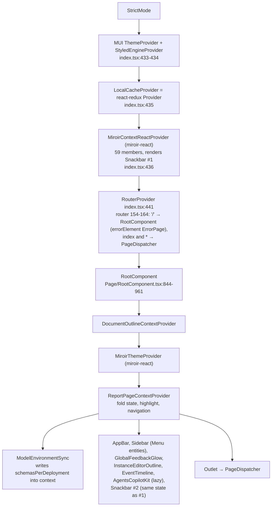
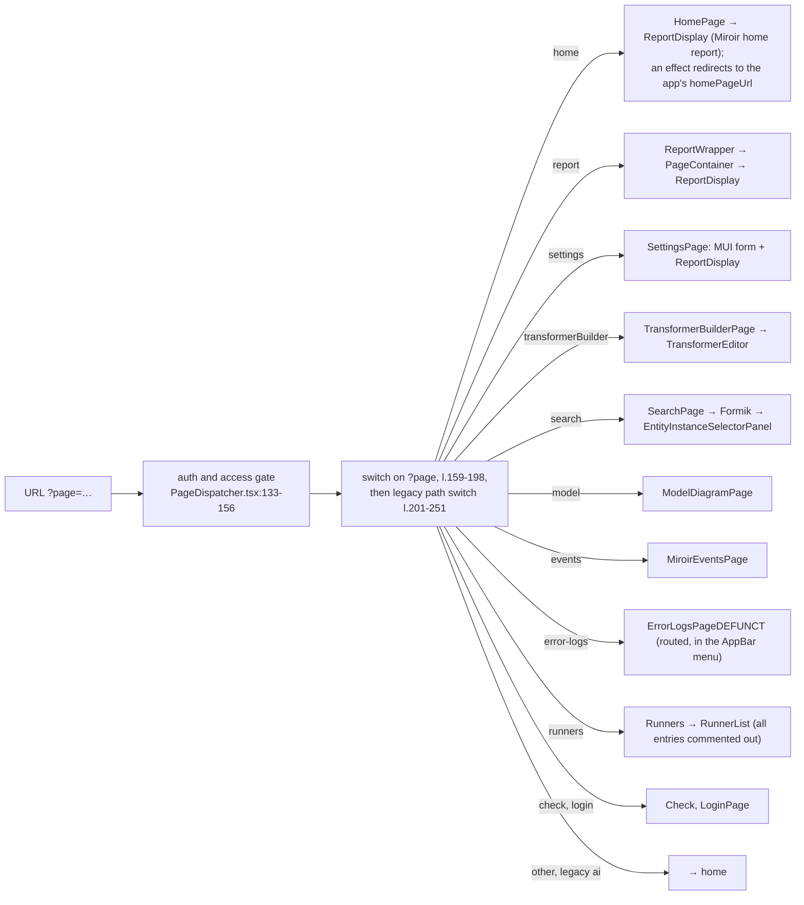
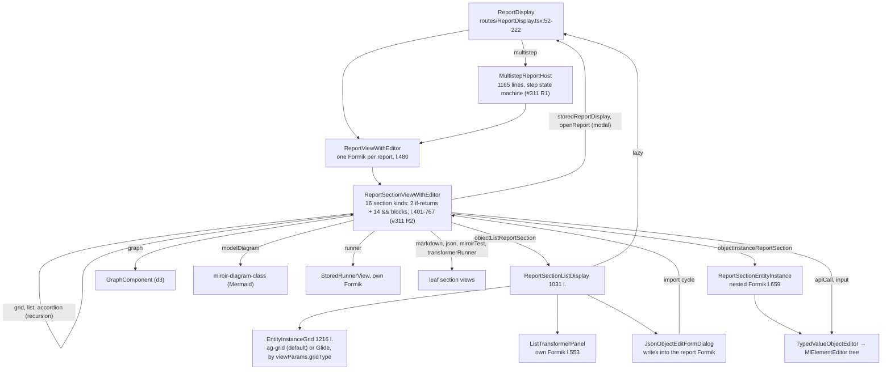
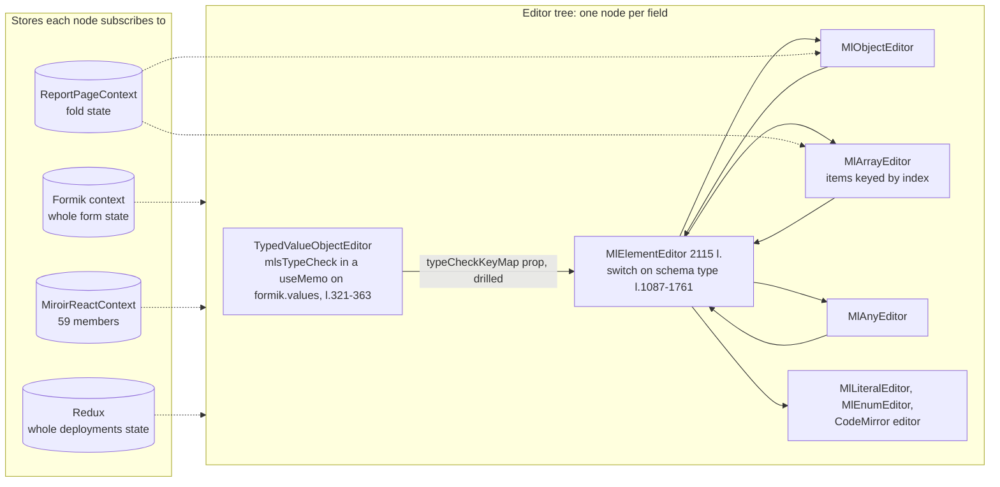
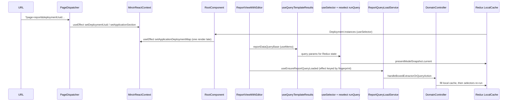

# Miroir UI architecture review

Date: 2026-10-06, revision 2 (after a second validation round, see §6 and `validation-log.md`). Code base: `_integration` at `9838983` (merge of #476).
Scope: `packages/miroir-standalone-app/src` (the web UI), `packages/miroir-react`, `packages/miroir-localcache-redux`, `packages/miroir-localcache-zustand`, `packages/miroir-diagram-class`, and `packages/miroir-sandbox` where it reuses the app.
Purpose: give UI PR reviews (human and agent) a picture of the present architecture, list the gaps and inconsistencies worth fixing first, and inventory what agents can read today before editing this code.

Every finding cites `file:line` on `_integration`. Line numbers are relative to `packages/miroir-standalone-app/src/miroir-fwk/4_view/` unless a package path is given. All behaviour claims were checked by reading the code; none was measured in a running app. Claims marked *(inferred)* follow from the code but were not reproduced.

## 1. Summary

The UI is a single Vite app (`miroir-standalone-app`, about 64k lines in `4_view`) on React 18, MUI 9, Formik, Redux and two grid libraries. A small shared package (`miroir-react`) holds the main React context, the theme and the local-cache imports. Reports are the backbone: most screens are Report entities rendered by one recursive component tree inside one Formik form per report.

The top level is consistent: reports and menus come from entities, pages are lazy-loaded, and there is one local cache. The problems are below that level:

1. **State has no single owner.** The selected deployment and application section live in the URL and in a 59-member React context; the application/deployment map lives in Redux, in that context and in props drilled through 22 files. Effects copy the values from one place to the other.
2. **The main context re-renders almost everything.** `MiroirReactContext` includes the snackbar and "action running" flags, so each toast or action re-renders every component that reads the context: 71 `useMiroirContextService` call sites in 63 app files, plus the hooks built on it, which every editor node calls. The same snackbar state is also rendered twice, so every toast appears twice.
3. **Editors subscribe too broadly.** Every node of the value editor tree reads the Formik context, the main context and the whole Redux deployments state; object and array editors also read the fold state. Ten components rebuild the selector map on every render, and in three of them a query re-runs on every render.
4. **No command layer.** 13 view files call the DomainController directly and build their actions by hand, with 42 endpoint-uuid literals in 11 files (#311 R3).
5. **MUI 5 to 9 migration left half-done.** The app runs MUI 9.4.0 and still has 32 type errors from MUI 5 props in its own code; `miroir-react` and `miroir-diagram-class` pin MUI 5.17.1 as a peer and are typechecked against it, while the bundle gives them 9.4.0.
6. **Duplicated theme code and about 6.7k lines of dead UI code** (about 3k of it code, the rest comments), including five runners that are still bundled behind a list whose entries are all commented out.
7. **Agents get little structural guidance, and the checks miss the UI.** AGENTS.md has four React bullets and does not describe the app's `miroir-fwk/4_view` layout; the code-quality skill covers code smells, not structure; the best architecture doc (`docs/internals/report-display.md`) is not linked from AGENTS.md or any skill. The `miroir/layers` lint rule does not apply to any app file, PR CI never typechecks the app (the UI libraries only through their `tsup` declaration builds), and runs no UI test.

Section 5 proposes the scope of a first issue and the outline of the guideline documents.

## 2. Synoptic schemas

### 2.1 Packages

The local-cache implementation is chosen by commenting blocks in `packages/miroir-react/src/miroir-localcache-imports.ts` (zustand block commented at lines 63-108). Zustand runs only in tests (`4-tests/localCacheImplementation.ts:50-60`).

### 2.2 Provider tree

Deeper contexts in production: `ReportFormSubmitContext`, Formik (8 live roots), `MultistepReportHostContext`, `FieldValidationContext`. `TransformerBuilderPage` and the Runners page mount a second `ReportPageContextProvider` (`routes/TransformerBuilderPage.tsx:374`, `routes/Runners.tsx:53`). `TransformerTypesDisplayContext`, `ComponentTestModeContext` and `PortalContainerContext` are provided only by the component-test harness (`4-tests/componentTests/runReactComponentTest.tsx:198-205`, `runReportTest.tsx:360-378`); in the app their consumers get the default value. `GridContext` is defined but never mounted.

### 2.3 Page dispatch

Pages are `React.lazy` (`PageDispatcher.tsx:37-47`). Report entities drive Home, Report, part of Settings and the Sidebar; Search, TransformerBuilder, Check, Events, Model and Login are hand-written.

### 2.4 Report rendering

### 2.5 Value editor tree and its state sources

Each dashed edge is a subscription: a change anywhere in that store re-renders the node. Formik changes on every keystroke anywhere in the report; Redux's deployments state changes on every cache write; the main context changes on every toast, action start and action end. None of the editors is wrapped in `React.memo`, and their props include JSX elements (`labelElement`, `deleteButtonElement`, …) that would defeat it. `MlEditorPropsRoot` has 32 props (`ValueObjectEditor/MlElementEditorInterface.ts:57`).

### 2.6 Read path

### 2.7 Write path

```mermaid
sequenceDiagram
  participant C as Component (13 view files)
  participant DC as DomainController
  participant Saga as PersistenceReduxSaga
  participant REST as RestClient or RestClientStub
  participant LC as LocalCache + UndoRedoReducer
  C->>DC: handleActionFromUI(action built by hand)
  Note over DC: trackAction, then the endpoint's actionImplementation<br/>(library function or composite template)
  alt instance action (handleInstanceAction, l.1304)
    DC->>Saga: callPersistenceAction (dispatched through the Redux store)
    Saga->>REST: network call (the stub calls an in-process server DomainController)
    REST-->>DC: result
    DC->>LC: callLocalCacheAction applies it to the cache
  else model action (handleModelAction, l.1828)
    DC->>LC: callLocalCacheAction, recorded in currentTransaction
    Note over DC: autocommit when the endpoint has autocommitFromUI (l.3080-3093)
    DC->>Saga: commit replays the transaction through callPersistenceAction
  end
  LC-->>C: useSelector re-render
```

### 2.8 Who owns which state

| State | Owner today | Also held in | Synced by |
|---|---|---|---|
| Instances and models | Redux `presentModelSnapshot` | — | — |
| Selected deployment, application section | URL | `MiroirReactContext` | effects in `PageDispatcher.tsx:92-98` (and the unrouted `routes/ReportPage.tsx:58-63`) |
| Application → deployment map | derived from Redux in `RootComponent` (identity stabilised by a shallow compare, `Page/RootComponent.tsx:273-286`) | `MiroirReactContext`, and props drilled through 22 files | effect `Page/RootComponent.tsx:310-315` |
| Schemas per deployment | `MiroirReactContext` | — | `useLayoutEffect` in `ModelEnvironmentSync`, fallback effects `ReduxHooks.ts:300`, `370` |
| Fold state of editors | `ReportPageContext` (one per RootComponent, one more per TransformerBuilder or Runners page) | setter pushed into `MiroirReactContext` | effect without cleanup `Reports/ReportPageContext.tsx:92-97` |
| Form values | Formik (one per report; 8 live Formik roots) | — | — |
| Snackbar, action running | `MiroirReactContext` | rendered by two Snackbars | — |
| Auth session, AI backend, render insight, cache monitor, perf config | module singletons | — | `useSyncExternalStore` (auth, AI), 1 s polling (cache monitor, render insight) |

## 3. Gaps and inconsistencies

IDs `U1`… are stable across revisions; U7 is withdrawn and U30-U34 are new in revision 2. `R1`-`R4` refer to the candidates of the #311 architecture review (`code-helpers/features/311-REFACTOR-architecture-review/analysis.md`), which this review confirms and does not repeat. Effort: S (under a day), M (a few days), L (a week or more).

### 3.1 State and data flow

| ID | Finding | Evidence | Effect | Effort |
|---|---|---|---|---|
| U1 | `MiroirReactContext` is a god-context: 59 members mixing services, selection, schema cache, Formik scratch state, UI flags, snackbar and `isActionRunning`. Its value is a `useMemo` whose deps include all of them. | interface `packages/miroir-react/src/contexts/MiroirContextReactProvider.tsx:126-237`, value 695-843, deps 800-843; `isActionRunning` toggled by `handleAsyncAction` (564-664) | Each toast, and each action run through `handleAsyncAction`, gives the context a new value, which re-renders every mounted consumer: 71 `useMiroirContextService` call sites in 63 files, plus the hooks on the same context (`useDomainControllerService` 15, `useSnackbar` 11, `useCurrentModelEnvironment`, …), together about 70 app files. Every value editor node is among them (`ReduxHooks.ts:272`). | M: split into services (stable), selection, schema cache, UI flags, notifications |
| U2 | Selection and the deployment map are duplicated and copied by effects (§2.8). | `PageDispatcher.tsx:92-98`, `Page/RootComponent.tsx:310-315`; the code-quality skill already notes the copy is "one render late" (`.agents/skills/miroir-code-quality/react.md:187`) | Extra render pass and one render where context and URL/Redux disagree. `components/Reports/useReportQueryLoadService.ts:13-21` works around identity churn of the map. | M: derive with hooks, drop the setters and the drilled props |
| U3 | Ten components call `getMemoizedReduxDeploymentsStateSelectorMap()` during render without `useMemo`. That function creates new `createSelector` instances on every call (`packages/miroir-localcache-redux/src/4_services/localCache/DomainStateMemoizedSelectors.ts:45-130`), so their cache is empty on every render. All ten use it to subscribe to the whole deployments state through `extractState`. In three of them (`MlLiteralEditor`, `RunnerView`, `Runner_CreateApplication`) a fresh `runQuery` selector and fresh query params (`defaultViewParamsFromAdminStorageFetchQueryParams`, `miroir-core/src/4_views/viewParams.ts:14`) go to `useReduxDeploymentsStateQuerySelectorForCleanedResult` (`ReduxHooks.ts:136-157`). | `ValueObjectEditor/MlObjectEditor.tsx:722`, `MlArrayEditor.tsx:451`, `MlLiteralEditor.tsx:390`, `MlEnumEditor.tsx:329`, `Reports/ReportSectionListDisplay.tsx:262`, `Reports/TypedValueObjectEditor.tsx:259`, `EndpointActionCaller.tsx:87`, `Runners/RunnerView.tsx:118`, `routes/TransformerBuilderPage.tsx:108`, `Runners/Runner_CreateApplication.tsx:1382`. Eight other call sites wrap it in `useMemo` (e.g. `Reports/ReportHooks.ts:136`). | These components re-render on every cache write. Each literal field re-runs the ViewParams query on every render, and Formik re-renders every field on every keystroke. | S: one hook per access pattern in `ReduxHooks.ts`, with memoized params |
| U4 | The UI is coupled to Redux by name and shape: `ReduxDeploymentsState`, `ReduxStateWithUndoRedo` and `state.presentModelSnapshot.current` appear in 13 view files; `MlEnumEditor.tsx:33-34` imports `react-redux` and `miroir-localcache-redux` directly; `4-tests/useSelectedApplicationMiroirTestSuiteRegistries.ts:49` subscribes to the whole store through `ReactReduxContext`, and two test buttons and the MiroirTest section in `4_view` use it. | as cited | The zustand implementation can't be swapped in without editing views; the "switch" is a commented block in `miroir-react`. Those three components re-render on every store change. | M |
| U5 | No command layer: 13 view files call the DomainController's `handle*` methods in live code (3 more only in commented-out code) and build their actions by hand (#311 R3). They hold 42 endpoint-uuid literals for 6 endpoints, in 11 files (2 of them dead). | `services/ConfigurationService.ts`, `Reports/ReportSectionListDisplay.tsx:504,534,560,592`, `Reports/MultistepReportHost.tsx`, `Reports/ReportViewWithEditor.tsx:374,411`, `Runners/RunnerView.tsx`, `scripts.ts`, … | Transaction rules differ per component. | M, see R3 |
| U6 | Service data read during render without a subscription: `useMiroirEventTrackingData()` returns `miroirActivityTracker.getAllActivities()`, a new sorted array on every call. | `packages/miroir-react/src/contexts/MiroirContextReactProvider.tsx:971-978`, `miroir-core/src/3_controllers/MiroirActivityTracker.ts:93-95`, `components/MiroirEventTimeline.tsx:78-115` | The timeline's `useMemo` recomputes on every render, and the timeline shows new events only when something else re-renders it (in practice, the U1 context changes). The tracker's `subscribe` method is commented out (`MiroirActivityTracker.ts:152`). | S |
| U7 | *Withdrawn.* Revision 1 called the 1 s polling of `LocalCacheMonitorSummary` and `RenderInsightSummary` a defect. `RenderInsightSummary` polls by design: subscribing would loop (`tools/renderInsightRegistry.ts:123-125`). The cache monitor has no subscription API. Both run only when their diagnostic setting is on. | — | — | — |
| U8 | About 30 of the 70 `useEffect`/`useLayoutEffect` calls in `4_view` copy props, URL, Redux or derived values into state, Formik or a context; about 8 load data, 6 subscribe or poll, about 22 handle DOM, listeners and cleanup, and 2 run debounce timers (`interactive/ApplicationSelector.tsx:148`, `TransformerEditor/TransformerEditor.tsx:588`). `RootComponent` has 7. | full list classified by reading each effect | Extra renders and ordering bugs. | per-site S |

### 3.2 Rendering cost of the editors (reports and forms)

| ID | Finding | Evidence | Effort |
|---|---|---|---|
| U9 | Type check per keystroke: `mlsTypeCheck` of the section value runs in a `useMemo` that depends on `formik.values`, so a keystroke anywhere in the report re-runs it. The result is drilled as `typeCheckKeyMap`, and falls back to a new `{}` literal on failure. | `Reports/TypedValueObjectEditor.tsx:321-363` (TODO at 327, dep at 357), fallbacks at 618 and 694 | M (with R4) |
| U10 | Fold state is one context value consumed by every object and array editor and by the fold buttons, so one fold re-renders all of them and their unmemoized children. `MlObjectEditor`'s attribute `useMemo` lists `formik` and the fold tree among its deps, so it recomputes on every keystroke and every fold. | `Reports/ReportPageContext.tsx:128-153`, `ValueObjectEditor/MlObjectEditor.tsx:1248-1350` | S-M |
| U11 | Array items are keyed by index. After a delete or reorder, React reuses item components by position, so local state (viewport reveal, CodeMirror text, structured/raw toggle) shows on the wrong item. | `ValueObjectEditor/MlArrayEditor.tsx:741` | S |
| U12 | Props drilling (R4): 32-prop root interface; `MlElementEditor` passes 31 props to `MlObjectEditor`, 25 of them unchanged; JSX-element props. | `ValueObjectEditor/MlElementEditorInterface.ts:57`, `MlElementEditor.tsx:1090-1122` | L, see R4; gate on the #303 render-performance suite |
| U13 | Rules-of-hooks violation: `TypedValueObjectEditorInner` returns early before calling `useCurrentModelEnvironment`, `useSelector` and several `useMemo`. The app counts 70 `rules-of-hooks` errors in `eslint-suppressions.json`, 8 of them in this file and 21 in `Themes/FormComponents.tsx`. | `Reports/TypedValueObjectEditor.tsx:215`, `249`, then hooks at 251, 261, 273, 321, 374, 378 | S per site |

### 3.3 Structure and consistency

| ID | Finding | Evidence | Effort |
|---|---|---|---|
| U14 | Report section dispatch covers the 16 kinds of the `ReportSection` union with 2 early-return `if`s and 14 `&&` JSX blocks; six different recursive walks over the section tree exist (R2). No registry, no documented way to add a kind. | `Reports/ReportSectionViewWithEditor.tsx:401-767`; walks in `ReportTools.ts:33,146`, `MultistepReportHost.tsx:225`, `ReportViewWithEditor.tsx:222`, `reportInputApplication.ts:33` | M, see R2 |
| U15 | Import cycles: `JsonObjectEditFormDialog` → `ReportSectionViewWithEditor` → `ReportSectionListDisplay` → `JsonObjectEditFormDialog`; `ReportSectionViewWithEditor` ↔ `routes/ReportDisplay`; `MlElementEditor` ↔ `MlObjectEditor`, `MlArrayEditor`, `MlAnyEditor`. | `JsonObjectEditFormDialog.tsx:35`, `ReportSectionViewWithEditor.tsx:29,43`, `ReportSectionListDisplay.tsx:77`, `routes/ReportDisplay.tsx:32-33` | S-M |
| U16 | Folder placement has no rule: `pages/` holds one page; `routes/` holds 8 dispatched pages plus `ReportDisplay` (a shared component) and `ReportPage` (unrouted); components sit at the `4_view` root (`EntityEditor`, `ModelEnvironmentSync`, `ErrorPage`, `ErrorLogsPageDEFUNCT`, `Importer`, …); `TypedValueObjectEditor`, the entry of the editor family, lives in `Reports/`; 15 test-UI files are in `Reports/`. | `ls 4_view` | S (`git mv`; mind U33) |
| U17 | Test infrastructure is part of the product: 8 `4_view` files import from `4-tests/`, and `Reports/ComponentTestSandbox.tsx:361,393` dynamically imports `4-tests/componentTests/index`, which imports `PageDispatcher` back (`runReportTest.tsx:32`). | as cited | M |
| U18 | `index.tsx` composes the platform, including an emulated server with hard-coded identity and access fixtures from `miroir-app-admin`. | `src/index.tsx:77-92, 290-309` | M |
| U19 | Routing is query-parameter based, but `HomePage.tsx:71`, `SearchPage.tsx:38` and `ReportPage.tsx:39` still read `useParams`. `routes/ReportPage.tsx` is not routed and is mounted only by 4 integration tests (`ReportPage.integ`, `multistepLaunch.274.phase5.integ`, `multistepProcess.274.integ`, `multistepBranch.284.integ`), so those tests exercise a wrapper production does not use. `navigation.ts:53-66` `instanceUrl()` builds `?page=instance`, which `PageDispatcher` doesn't handle (latent: its only caller, `EntityInstanceLink`, has no live importer). | as cited | S |
| U30 | **New.** Every toast is shown twice: `MiroirContextReactProvider` renders a Snackbar (bottom center) and `RootComponent` renders a second one (bottom right) from the same state through `useSnackbar`. | `packages/miroir-react/src/contexts/MiroirContextReactProvider.tsx:849-863`, `Page/RootComponent.tsx:138-142, 947-956` | S |
| U31 | **New, inferred.** Fold actions from the outline can stop working after a visit to TransformerBuilder or Runners. Their nested `ReportPageContextProvider` pushes its own fold setter into the main context in an effect without cleanup; after unmount the context keeps the dead setter, and the root provider's effect does not run again because its dependency is a stable state setter. The outline calls that setter on double-click. | `Reports/ReportPageContext.tsx:92-97`, `routes/TransformerBuilderPage.tsx:374`, `routes/Runners.tsx:53`, `packages/miroir-react/src/contexts/MiroirContextReactProvider.tsx:305`, `InstanceEditorOutline.tsx:227-234` | S |
| U32 | **New.** Product routes import example fixtures: `SearchPage` imports `deployment_Library_DO_NO_USE` and `entityBook` from `miroir-example-library`; `TransformerBuilderPage` imports from it too. | `routes/SearchPage.tsx:24`, `routes/TransformerBuilderPage.tsx:35` | S |

### 3.4 Dependencies, theme, dead code

| ID | Finding | Evidence | Effort |
|---|---|---|---|
| U20 | The MUI 5 to 9 migration is half-done. The app and `miroir-sandbox` install `@mui/material` 9.4.0 (nested); `miroir-react` and `miroir-diagram-class` pin `@mui/material` 5.17.1 as a peer, which keeps 5.17.1 at the root. Dependabot commit `df011eb` (2026-09-30) bumped the app and pinned those peers in the same commit. Vite resolves `@mui/material` from the app (`vite.config.js:82,103`), and the bundle report of a build in this container lists only the 9.4.0 copy (`dist/.vite/bundle-report.json`), so the two libraries are typechecked against 5.17.1 and run on 9.4.0. Separately, the app's own code still uses MUI 5 props: `tsc` on the app gives 32 MUI errors (mostly Grid `item`, then system props on Typography and Stack, `paragraph`, `PaperProps`, `primaryTypographyProps`, `InputProps`, Switch `inputProps`) in `ErrorLogsPageDEFUNCT` (13), `MiroirEventsPage` (11), `MiroirEventTimeline` (3) and 5 other files. | each `package.json`; `tsc` run on 2026-10-06 after rebuilding `miroir-core` (§6) | M: move the peers to 9, fix the 32 errors. Runtime risk in the libraries is low today (Alert, Snackbar, Box, Typography, ToggleButton, Tooltip). |
| U21 | Theme code duplicated: `MiroirTheme.ts` is identical in both packages (718 lines), `TableTheme.ts` and `ThemeColorDefaults.ts` differ only in imports. The local copies are still imported by `Themes/index.ts`, `Grids/ValueObjectGrid.tsx:34`, `MiroirThemeSelector.tsx:15` (live through Settings), `Themes/TableStyleGenerators.ts:1`, `Themes/resolveMiroirIconColor.ts:2` and the orphan `src/IconTest.tsx:8`. | `components/Themes/` vs `packages/miroir-react/src/components/Themes/` | S |
| U22 | Styling has no rule. Outside `components/Themes` (8,281 lines of `Themed*` wrappers): 48 files import a `Themed*` component, 28 import `@mui/material` directly, and there are 398 inline `style={{`, `sx` in 22 files, 41 `` css` ``/`css(` and 51 `css={` usages; colours are hard-coded in places (`Page/AppBar.tsx:41-42`, `Reports/TypedValueObjectEditor.tsx:216-222`). `theme-bypass` is a lens warning, not a lint error. | counts on non-comment lines | guideline + gradual |
| U23 | Two form libraries declared, one used: Formik 2.4.9 is imported in 33 app source files; `react-hook-form` (declared by the app and by `miroir-react`) and `@hookform/resolvers` have no live import. | `miroir-standalone-app/package.json`, `miroir-react/package.json:32` | S |
| U24 | Two grid libraries: ag-grid 31 (default) and Glide 6, chosen in Settings. Data preparation, column definitions, themes and pagination are shared, but each grid component carries two render paths and two sets of click, edit, delete and duplicate handlers (Glide part about 1.2k lines), and features are not at parity ("Clear all filters" exists for ag-grid only). | `Grids/EntityInstanceGrid.tsx:138,1096-1176`, `Grids/ValueObjectGrid.tsx:256-298` vs `413-454` | decision for A |
| U25 | About 6.7k lines of dead UI code, about 3k of them code. Orphans (no static, lazy or test importer, and unreachable from `src/index.tsx`): `Importer.tsx` (2436 lines, 2150 commented), `EndpointActionCaller.tsx`, `Runners/ImportEntityFromSpreadsheetRunner.tsx`, `Runners/LibraryRunner_LendDocument.tsx`, `SimpleEditor.tsx`, `CellRenderers.tsx` (empty), `useStyles.ts`, `ChangeValueTypeSelect.tsx`, `MlElementDisplay.tsx`, `PerformanceDisplayContainer.tsx`, `IconExtractionDemo.tsx`, `test-icon-extraction.ts`, `EntityInstanceLink.tsx`, `Grids/GridContextProvider.tsx`, `Grids/TableActionButtons_new.tsx`, `Graph/index.ts`, `Reports/FormikValueObjectContext.tsx`, `Reports/TransformerTestResults.tsx`, `Themes/ThemeUtils.ts`, `ViewParamsUpdateQueueTestUtils.ts`, `src/IconTest.tsx`. The five `Runner_*.tsx` files (1,760 lines) are statically imported by `Runners/RunnersList.tsx:11-17`, so they are bundled, although every list entry is commented out (31-62) and the Runners page shows only a title. A unit test imports a re-export through `Runner_CreateApplication.tsx:55`. `ErrorLogsPageDEFUNCT.tsx` is routed and linked from the AppBar menu (`Page/AppBar.tsx:525-531`). | reachability pass from `src/index.tsx` | S (redirect the test import first; confirm the runner list with A) |
| U26 | Declared dependencies with no import. App: `@hilla/react-components`, `react-responsive-carousel`, `react-select`, `prop-types`, `mock-socket`, `@redux-devtools/core`, `@copilotkit/react-textarea`. `miroir-react`: `miroir-localcache-zustand` and `react-redux` (only in a commented block), `@redux-devtools/core`, `react-error-boundary`, `react-markdown`, `react-router-dom`, `react-select`. Both local caches list `miroir-example-library` as a runtime dependency though only their tests import it. `miroir-localcache` has empty `src/index.ts` and `constants.ts` but 460 lines of tests against localcache-redux and is still built. | `package.json` files, `build-all.sh:70,98` | S |
| U33 | **New.** `miroir-sandbox` aliases `@miroir-app` to the app's `src` and imports `RootComponent`, `PageDispatcher`, `ErrorPage` and services from it. It is built only on push to `main`, so renaming or deleting `4_view` files (U16, U25) can break it without any PR check failing. | `packages/miroir-sandbox/vite.config.js:10,32`, `.github/workflows/build-sandbox-for-github-pages.yml:4-6` | S: build the sandbox in PR CI |

### 3.5 Checks that would catch regressions

| ID | Finding | Evidence |
|---|---|---|
| U27 | PR CI runs `tsc` only on `miroir-core`. The bundle job builds `miroir-react`, `miroir-diagram-class` and `miroir-localcache-redux` with `tsup` `dts: true` when `packages/` changes, which fails on type errors, so those libraries are typechecked indirectly. The app and `miroir-localcache-zustand` are never typechecked. The app's `tsconfig.json` excludes `tests/**`; a `tsconfig.tests.json` that includes them exists but nothing uses it. | `.github/workflows/pr-checks.yml:46, 104-108` |
| U28 | No UI test runs in PR CI. 29 nonreg steps have scope `ui` (20 in the unit tier, 9 in the default tier); they run only locally. | `scripts/nonreg-manifest.json` |
| U29 | `react-hooks/exhaustive-deps` and `theme-bypass` are lens warnings only. The app counts 138 lint violations in `eslint-suppressions.json`: `rules-of-hooks` 70, `type-escape` 24, `set-state-in-effect` 13, `action-result` 13, `global-environment` 7, `component-io` 5, `max-depth` 4, `pub-sub` 2. | `eslint-suppressions.json`, `eslint-rules/smell-lens.config.mjs:144-145, 220` |
| U34 | **New.** The `miroir/layers` lint rule never applies to the app. It reads the first directory under `packages/<pkg>/src/` and expects `<digit>_`; in the app that directory is `miroir-fwk`, so `4_view` is never recognised as a layer (and `4-tests` uses a hyphen). It covers only `miroir-diagram-class` and `miroir-sandbox` among UI packages, and nothing in `miroir-react`, which has no numbered directories. | `eslint-rules/miroir-layers.mjs:6-15`; 0 `miroir/layers` suppressions outside core and postgres |

## 4. What agents can read today

| Source | UI content | Found by an agent? | Accuracy |
|---|---|---|---|
| `AGENTS.md` (via `CLAUDE.md`, `.github/copilot-instructions.md`) | 4 React bullets (hooks, ask before `useEffect`, props and hooks for data, no pub-sub, service data through a hook); layer list; "Redux + Redux-Sagas"; names the `ui`/`report` MiroirTest kinds, the Miroir Tests menu and `miroir-react` (build order only); asks to typecheck the packages you touch | always loaded | The layer list (`4_views/`) is right for `miroir-core`, but the UI packages use `4_view`, nested under `miroir-fwk/` in the app, and the list doesn't say so. Nothing on MUI, Formik, theming, zustand, or the role of `miroir-react` |
| Skill `miroir-code-quality` (#476): `SKILL.md`, `react.md`, `miroir.md`, `layering.md`, `typescript.md`, `lens.md`; `npm run smells` | 29 smells: 8 React ones in `react.md` (`hooks-order`, `effect-derived-state`, `state-from-props`, `component-io`, `pub-sub`, `service-read-in-render`, `unstable-deps`, `prop-drilling`) and 2 UI-related ones in `miroir.md` (`theme-bypass`: colours through `useMiroirTheme`/`Themed*`; `mocked-own-module`: write a MiroirTest `ui.*` suite). Sanctioned patterns (`useAuthSession`, `useYamlParserStatus`, `TransformerTypesDisplayContext`) exist. A few placement rules (I/O through DomainController hooks or a client the root builds; context instead of drilling) | yes, its description says "before writing new code" under `packages/` | The most accurate source. No folder map, provider tree or state-ownership rules |
| Lint (`eslint.config.mjs`, `eslint-rules/`) | errors on UI files: `rules-of-hooks`, `set-state-in-effect`, `miroir/pub-sub`, `miroir/component-io`, `miroir/logger`, `miroir/type-escape`, `miroir/action-result`, `miroir/global-environment`, `max-depth` 4, `preserve-caught-error`, `no-mixed-operators`, a jzod import ban | enforced by `npm run lint` in CI | `miroir/layers` is inert in the app (U34) |
| Skill `miroir-analysis-to-tdd-plan` | maps UI packages to nonreg scope `ui` | yes, for feature work | Gives the path `src/4_view` (`SKILL.md:95`); its test-vehicle table sends "React internals" to vitest (`SKILL.md:50`) and never names the MiroirTest `reactComponentTest` / `reportTest` leaves, against AGENTS.md:100, which prefers MiroirTest |
| `docs/internals/report-display.md` (20 KB) | The best UI architecture doc: glossary (RVWE, RSVWE, TVOE), the providers under `RootComponent` (:32), stack down to `MlElementEditor`, "One Formik per `ReportViewWithEditor` mount" (:51-53), "What lives in the bag" (:69), 7 feedback loops, a "practical rule for future changes" (:170), 8 refactoring checkpoints (:208), 22 key-file rows (all files exist) | Not from AGENTS.md or any skill. Linked from `docs/guides/developer/designing-reports.md` (an empty placeholder that `docs/index.md` links) and from the #246 analysis and plan | Content from 2026-09-10 (#267), last touched 2026-09-26; spot-checks still hold |
| `docs/internals/list-report-section-sizing.md`, `code-splitting.md`, `application-startup.md` | grid sizing modes; Vite chunks, lazy routes, bundle guards; client/server DomainController pair | sizing: no doc links it; code-splitting: linked from `using-ai.md`, `process-capabilities.md`, `pr-checks.yml`, `check_bundle_policy.py`; startup: one hop from AGENTS.md through `data-architecture-deployments.md` | `code-splitting.md` current (2026-10-05) |
| `docs/guides/advanced/performance.md`, `interaction-glow.md` | render-insight instrumentation (`useRenderInsight`, `RenderInsightHeader`), theme tokens; the `FeedbackGlowBoundary` API and `data-miroir-no-glow` | linked from `docs/index.md` | not spot-checked |
| `docs/reference/api/reports.md` | catalogue of report section types | linked from `report-display.md` and `docs/index.md` | marked "SLOPPY" in its title |
| `docs/theme-color-defaults-findings.md` | theme resolution, minimal theme | no | its paths resolve, but point at the app's re-exports and copies rather than the canonical files in `miroir-react` |
| `docs/contributing/code-style.md` | 3 React bullets repeating AGENTS.md, logger setup; "Naming", "File Organization", "Documentation" and "Linting" are "(Content to be added)" | yes | placeholder |
| `docs/contributing/testing.md`, `docs/guides/developer/testing.md`, `docs/reference/testing.md` (141 KB) | thorough on UI tests: `ui.*` suites, `reactComponentTest`, `reportTest`, `measureRendering` (`MIROIR_COMPONENT_PERF=1`), running tests in the UI | yes | current; registering a component as a test target (`componentRegistry.ts`) appears only twice in the reference |
| `packages/miroir-standalone-app/docs/BlobEditing.md` | blob editing in the entity editors | no doc links it | not spot-checked |
| `code-helpers/features/*` (about 30 UI folders: 225, 246, 247, 274, 281, 286, 292, 303, 317, 330, 333, 383, 415, 438, 453, …) and #311 R1-R4 | per-feature analyses and plans; #281 D4-a lists the files a new section kind touches | only by search, no index | point-in-time |
| `.github/skills/README.md` | skill index | rarely | lists the transformer skills only |
| Package READMEs, nested AGENTS.md, PR template | none for the UI packages; no PR template in the repo | — | — |

**Partly covered, but scattered:** the provider tree (only the `RootComponent` part, in `report-display.md`); state ownership (`report-display.md` "What lives in the bag", and the prop-drilling smell); theming (the `theme-bypass` smell, nothing on `sx`); performance (render insight in `performance.md`, `MIROIR_COMPONENT_PERF`, the `unstable-deps` smell); a review checklist (`report-display.md` checkpoints, the code-quality "Review a change" workflow); adding a section kind (#281 D4-a, #311 R2 file list).

**Not covered anywhere:** where new code goes (`miroir-react` vs `4_view/components|routes|pages|contexts|services`); that the app runs MUI 9 while `miroir-react` is typed against 5; that Formik is the only form library; how to read the local cache without coupling to Redux; how to add an `Ml*Editor`, a page or a context; selector granularity, context-value stability and when to use `React.memo`.

## 5. Proposed next steps

### 5.1 First issue: quick, low-risk fixes

Each is a separate commit and makes later work easier to review:

1. Delete the dead code of U25 after A confirms the runner list; redirect the unit test that imports through `Runner_CreateApplication.tsx` first (S).
2. Delete the theme copies in the app and import from `miroir-react`, including in `MiroirThemeSelector`, `TableStyleGenerators.ts` and `resolveMiroirIconColor.ts` (U21) (S).
3. Remove the unused dependencies of U23 and U26; move `miroir-example-library` to devDependencies of the local caches (S).
4. Memoize selector maps and query params through `ReduxHooks.ts` hooks (U3), and fix the hook-order violations in `TypedValueObjectEditor` (U13) (S).
5. Move snackbar and `isActionRunning` out of `MiroirReactContext` into their own context, and render one Snackbar (U1 first slice, U30) (S).
6. Subscribe the event timeline to the activity tracker (U6) (S).
7. Fix the stale routing leftovers (U19) and the fold setter cleanup (U31) (S).
8. Make `miroir/layers` see layers under `miroir-fwk/` (U34); expect new violations, to be counted in `eslint-suppressions.json` (S-M).
9. Add `tsc --noEmit` for `miroir-localcache-zustand` to `pr-checks.yml`, the app once U20 is done (U27), and a sandbox build (U33) (S).

U20 (peers to MUI 9, fix the 32 errors) fits in the same issue or right after it, since it unblocks the app typecheck.

### 5.2 Larger refactors, each its own issue

- U1 + U2: split the god-context and derive selection and the deployment map instead of copying them.
- R3 (U5): an entity command module between views and the DomainController.
- R2 (U14, U15): a section registry and one section-tree module.
- R1: the multistep engine out of `MultistepReportHost`.
- R4 (U9-U12): an editor-tree session, measured with the #303 render-performance suite before and after.
- U4: local-cache-neutral hooks and names, if swapping to zustand is still a goal.
- U17: move test UI and the test harness behind a lazy boundary so the product doesn't import `4-tests`.
- U24: keep one grid library, or document why both stay.

### 5.3 Guideline documents for agents

1. `docs/internals/ui-architecture.md`: the diagrams of §2, the state ownership table, the provider tree, the folder map with "where new code goes", and links to `report-display.md`, `list-report-section-sizing.md`, `code-splitting.md`, `performance.md`, `reports.md`.
2. A `miroir-ui` skill (or a `ui.md` part of `miroir-code-quality`): the rules for new UI code (data through `ReduxHooks.ts`-style hooks, actions through the command module once R3 exists, one Formik per report, theming through `useMiroirTheme`/`Themed*`, stable context values, keys, when to add `React.memo`), a UI PR review checklist, and the how-tos (new section kind, new editor, new page). A new skill also needs `python scripts/sync_agent_skills.py` and an entry in `.github/skills/README.md`.
3. AGENTS.md: describe the UI layout (`miroir-fwk/4_view`, `miroir-react`) next to the layer list, and add one line pointing to 1 and 2. Add the app to the pre-push typecheck only after U20.
4. Fix the drift in `miroir-analysis-to-tdd-plan` (path, MiroirTest UI leaves) and point the theme doc at `miroir-react`.

## 6. Second-round validation (revision 2)

Method: three independent passes re-checked every claim of revision 1 against the code (one per part: editors and structure; dependencies, dead code, CI and metrics; agent guidance), and I re-checked the data-flow findings and the read and write paths myself. I re-ran `tsc` on the UI packages after rebuilding `miroir-core` (this container's `dist/` predated #449 and #472 and showed 25 false errors), and rendered every diagram in headless Chromium with Mermaid 11.12. `validation-log.md` lists each correction with its evidence.

Outcome:

- **Confirmed:** the main structural findings (U1, U2, U4, U9, U13-U14, U17-U21, U25, U27-U29) and all seven diagrams parse.
- **Corrected:** wrong counts or line numbers (U1 lines, U3 mechanism, U4, U5, U12, U22, U25 size and list, appendix), wrong behaviour wording (U11, U20 causality, U27), and several diagram edges (§2.2, §2.3, §2.4, §2.5 redrawn, §2.7 redrawn with instance and model branches).
- **Withdrawn:** U7 (polling is deliberate).
- **New:** U30 double toast, U31 stale fold setter (inferred), U32 example fixtures in product routes, U33 sandbox coupling, U34 inert layers rule; unused dependencies added to U26; the `4_view` ↔ `4-tests` dynamic cycle added to U17; the always-invalidated `MlObjectEditor` memo added to U10.

## Appendix: metrics (`4_view`, non-comment lines unless stated)

| Metric | Value |
|---|---|
| Files | 156 `.tsx`, 84 `.ts`, 64,288 lines (14% `//` comment lines, 16.5% with block comments) |
| Files over 500 / 1000 lines | 43 / 8 |
| Largest | `Importer.tsx` 2436, `MlElementEditor.tsx` 2115, `Runner_CreateApplication.tsx` 1562, `MlObjectEditor.tsx` 1533, `EntityInstanceGrid.tsx` 1216, `MultistepReportHost.tsx` 1165 |
| Hooks | `useMemo` 326, `useCallback` 210, `useState` 183, `useEffect` + `useLayoutEffect` 70, `useSelector` 30, `React.memo`/`memo` 11 (10 live) |
| `createContext` | 10 live in the app (plus the dead `GridContext`), 2 in `miroir-react`, 1 in localcache-zustand |
| `useMiroirContextService` | 71 call sites in 63 app files (69 in 61 under `4_view`) |
| `useMiroirTheme` | 112 calls in 36 files |
| Formik roots / `useFormikContext` files | 8 live roots (10 including 2 in dead files) / 19 live files |
| Counted lint violations (app) | 138 (70 `rules-of-hooks`) |
| `tsc --noEmit` (fresh `miroir-core` build) | app 36 = 32 MUI + 4 missing `node_modules` links for `miroir-app-meta` and `miroir-example-github` in this container; `miroir-react`, `miroir-diagram-class`, both local caches 0 |
