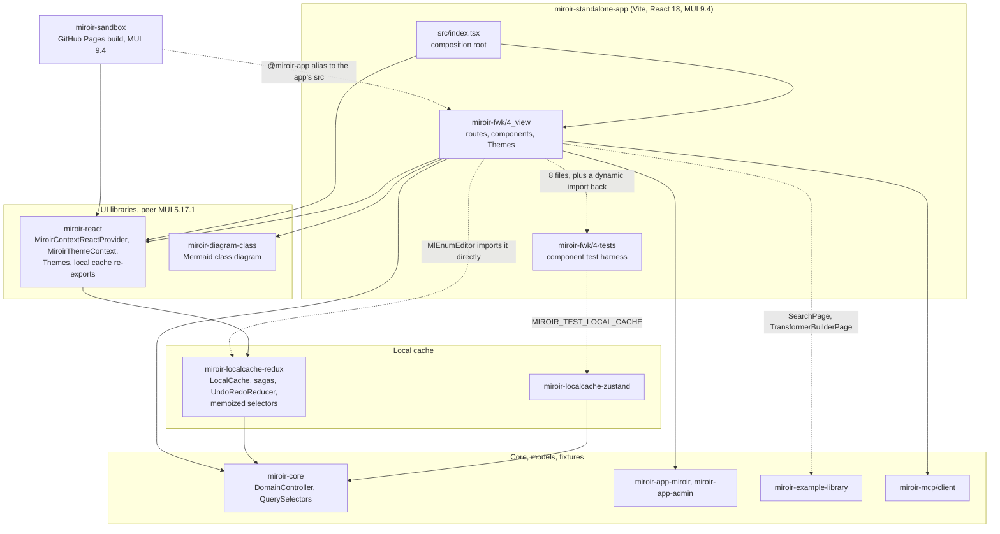
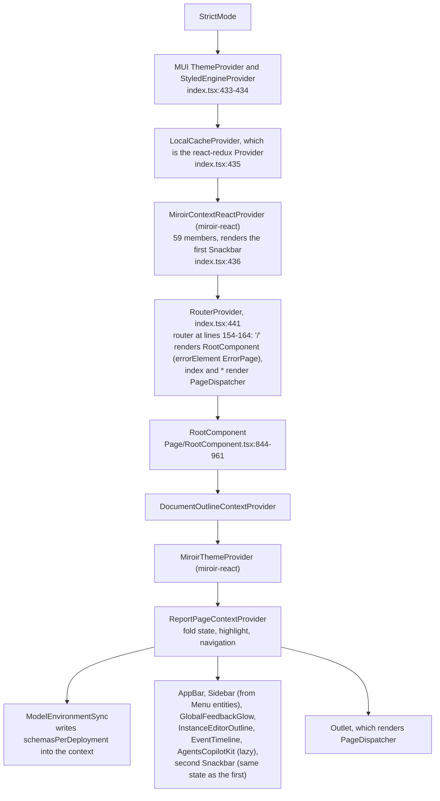
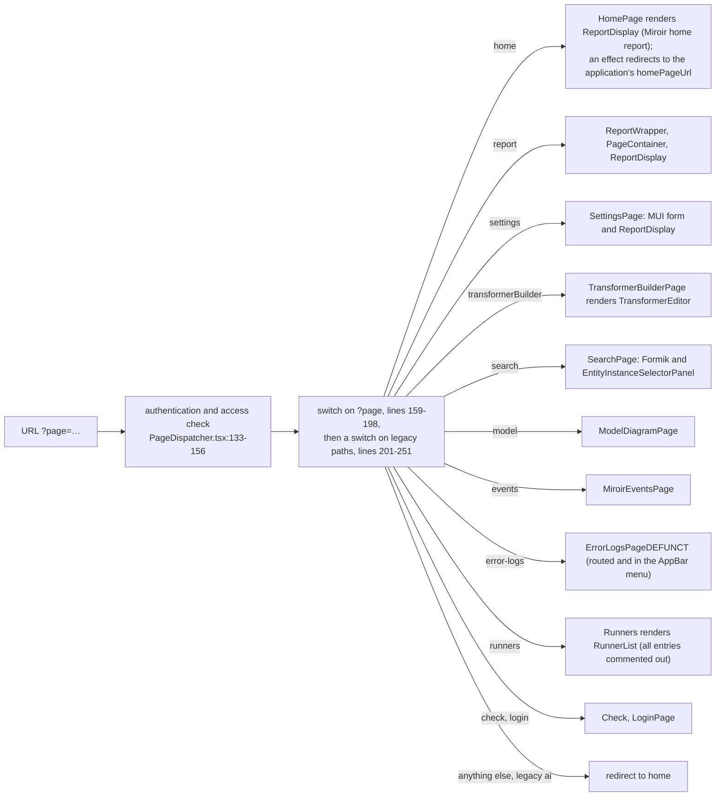
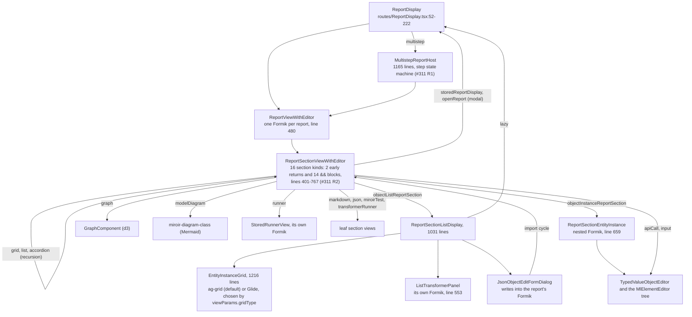
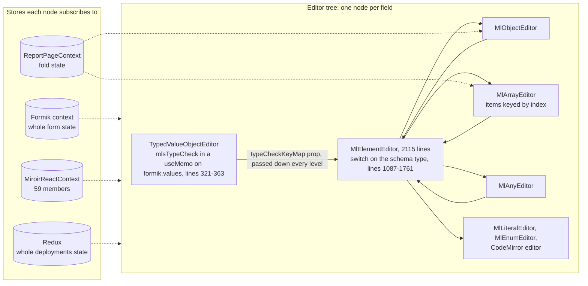
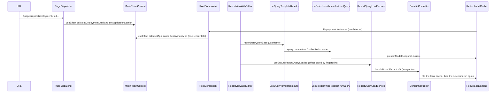
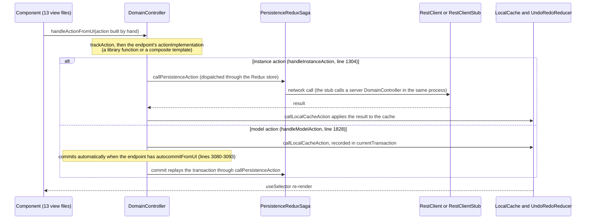

# Miroir UI architecture review

Date: 2026-10-06, revision 2, after a second validation round (see section 6 and `validation-log.md`). Plain-language edit on 2026-10-23. Code base: `_integration` at `9838983` (merge of #476).

Scope: `packages/miroir-standalone-app/src` (the web UI), `packages/miroir-react`, `packages/miroir-localcache-redux`, `packages/miroir-localcache-zustand` and `packages/miroir-diagram-class`, plus `packages/miroir-sandbox` where it reuses the app.

Purpose: help people and agents review UI pull requests. The review describes the present architecture, lists the gaps and inconsistencies worth fixing first, and lists what agents can read today before they edit this code.

Every finding cites `file:line` on `_integration`. Line numbers are relative to `packages/miroir-standalone-app/src/miroir-fwk/4_view/` unless a package path is given. All claims about behaviour come from reading the code; nothing was measured in a running app. Claims marked *(inferred)* follow from the code but were not reproduced.

## 1. Summary

The UI is one Vite app, `miroir-standalone-app`, with about 64k lines in `4_view`. It uses React 18, MUI 9, Formik, Redux and two grid libraries. A small shared package, `miroir-react`, holds the main React context, the theme and the local cache imports. Most screens are Report entities. One recursive component tree renders them, with one Formik form per report.

The top level is consistent. Reports and menus come from entities, pages load lazily, and there is one local cache. The problems sit below that level:

1. **State has no single owner.** The selected deployment and application section live in the URL and in a React context with 59 members. The map from applications to deployments lives in Redux, in that context, and in props passed down through 22 files. Effects copy the values from one place to another.
2. **The main context re-renders almost everything.** `MiroirReactContext` holds the snackbar state and the "action running" flag. So each notification, and each action, re-renders every component that reads the context: 71 `useMiroirContextService` calls in 63 app files, plus the hooks built on the same context, which every editor node calls. Two Snackbar components also show the same state, so every notification appears twice.
3. **Editors subscribe to too much.** Every node of the value editor tree reads the Formik context, the main context and the whole Redux deployments state. Object and array editors also read the fold state. Ten components rebuild the selector map on every render, and three of them re-run a query on every render.
4. **No command layer.** 13 view files call the DomainController directly and build their actions by hand. They hold 42 endpoint uuids written as literals, in 11 files (#311 R3).
5. **The MUI 5 to 9 migration is incomplete.** The app runs MUI 9.4.0, and its own code still has 32 type errors from MUI 5 props. `miroir-react` and `miroir-diagram-class` declare MUI 5.17.1 as a peer and are typechecked against it, while the bundle gives them 9.4.0.
6. **Duplicated theme code and about 6.7k lines of dead UI code.** About 3k of those lines are code and the rest are comments. Five runners still ship in the bundle, although every entry of the list that shows them is commented out.
7. **Agents get little guidance on structure, and the checks miss the UI.** AGENTS.md has four React bullets and does not describe the app's `miroir-fwk/4_view` layout. The code-quality skill covers code smells, not structure. The best architecture document, `docs/internals/report-display.md`, is not linked from AGENTS.md or from any skill. The `miroir/layers` lint rule applies to no app file. PR CI never typechecks the app (the UI libraries only through their `tsup` declaration builds), and it runs no UI test.

Section 5 proposes the scope of a first issue and an outline for the guideline documents.

## 2. Diagrams

### 2.1 Packages

Developers choose the local cache implementation by commenting blocks in or out in `packages/miroir-react/src/miroir-localcache-imports.ts`; the zustand block is commented out at lines 63-108. Zustand runs only in tests (`4-tests/localCacheImplementation.ts:50-60`).

### 2.2 Provider tree

Deeper contexts in the running app: `ReportFormSubmitContext`, Formik (8 live Formik roots), `MultistepReportHostContext` and `FieldValidationContext`. `TransformerBuilderPage` and the Runners page mount a second `ReportPageContextProvider` (`routes/TransformerBuilderPage.tsx:374`, `routes/Runners.tsx:53`). Only the component test harness provides `TransformerTypesDisplayContext`, `ComponentTestModeContext` and `PortalContainerContext` (`4-tests/componentTests/runReactComponentTest.tsx:198-205`, `runReportTest.tsx:360-378`); in the app, their consumers get the default value. `GridContext` is defined but never mounted.

### 2.3 Page dispatch

Pages load through `React.lazy` (`PageDispatcher.tsx:37-47`). Report entities drive the Home page, the Report page, part of the Settings page and the Sidebar. The Search, TransformerBuilder, Check, Events, Model and Login pages are written by hand.

### 2.4 Report rendering

### 2.5 Value editor tree and the stores it reads

Each dashed edge is a subscription: a change anywhere in that store re-renders the node. Formik changes on every keystroke anywhere in the report. The Redux deployments state changes on every cache write. The main context changes on every notification and at the start and end of every action. No editor uses `React.memo`, and their props include JSX elements (`labelElement`, `deleteButtonElement` and others) that would defeat it. `MlEditorPropsRoot` has 32 props (`ValueObjectEditor/MlElementEditorInterface.ts:57`).

### 2.6 Read path

### 2.7 Write path

### 2.8 Who owns which state

| State | Owner today | Also held in | Kept in sync by |
|---|---|---|---|
| Instances and models | Redux `presentModelSnapshot` | none | none |
| Selected deployment and application section | URL | `MiroirReactContext` | effects in `PageDispatcher.tsx:92-98` (and in the unrouted `routes/ReportPage.tsx:58-63`) |
| Map from applications to deployments | computed from Redux in `RootComponent`, which keeps the same object while the contents stay equal (`Page/RootComponent.tsx:273-286`) | `MiroirReactContext`, and props passed down through 22 files | effect at `Page/RootComponent.tsx:310-315` |
| Schemas per deployment | `MiroirReactContext` | none | `useLayoutEffect` in `ModelEnvironmentSync`; fallback effects at `ReduxHooks.ts:300` and `370` |
| Fold state of the editors | `ReportPageContext` (one under RootComponent, one more on the TransformerBuilder and Runners pages) | its setter is copied into `MiroirReactContext` | effect without cleanup at `Reports/ReportPageContext.tsx:92-97` |
| Form values | Formik (one per report; 8 live Formik roots) | none | none |
| Snackbar state, "action running" flag | `MiroirReactContext` | shown by two Snackbar components | none |
| Authentication session, AI backend, render insight, cache monitor, performance settings | module-level singletons | none | `useSyncExternalStore` (authentication, AI); polling every second (cache monitor, render insight) |

## 3. Gaps and inconsistencies

IDs `U1` and up stay the same across revisions. U7 is withdrawn, and U30 to U34 are new in revision 2. `R1` to `R4` are the candidates of the #311 architecture review (`code-helpers/features/311-REFACTOR-architecture-review/analysis.md`); this review confirms them and does not repeat them. Effort: S is under a day, M a few days, L a week or more.

### 3.1 State and data flow

| ID | Finding | Evidence | Effect | Effort |
|---|---|---|---|---|
| U1 | `MiroirReactContext` holds everything: 59 members that mix services, the current selection, the schema cache, Formik helper state, UI settings, the snackbar state and `isActionRunning`. Its value is a `useMemo` that depends on all of them. | interface at `packages/miroir-react/src/contexts/MiroirContextReactProvider.tsx:126-237`, value at 695-843, dependencies at 800-843; `handleAsyncAction` sets `isActionRunning` (564-664) | Each notification, and each action run through `handleAsyncAction`, gives the context a new value. That re-renders every mounted consumer: 71 `useMiroirContextService` calls in 63 files, plus the hooks on the same context (`useDomainControllerService` 15 calls, `useSnackbar` 11, `useCurrentModelEnvironment` and others), about 70 app files in all. Every value editor node is one of them (`ReduxHooks.ts:272`). | M: split it into services (stable), selection, schema cache, UI settings and notifications |
| U2 | The selection and the deployment map exist in several places, and effects copy them (section 2.8). | `PageDispatcher.tsx:92-98`, `Page/RootComponent.tsx:310-315`; the code-quality skill already says the copy arrives "one render late" (`.agents/skills/miroir-code-quality/react.md:187`) | One extra render, during which the context disagrees with the URL or Redux. `components/Reports/useReportQueryLoadService.ts:13-21` works around the map getting a new object after cache writes. | M: compute them with hooks and remove the setters and the props passed down |
| U3 | Ten components call `getMemoizedReduxDeploymentsStateSelectorMap()` during render without `useMemo`. Each call creates new `createSelector` instances (`packages/miroir-localcache-redux/src/4_services/localCache/DomainStateMemoizedSelectors.ts:45-130`), so their cache starts empty on every render. All ten use the map to subscribe to the whole deployments state through `extractState`. In three of them (`MlLiteralEditor`, `RunnerView`, `Runner_CreateApplication`), a new `runQuery` selector and new query parameters (`defaultViewParamsFromAdminStorageFetchQueryParams`, `miroir-core/src/4_views/viewParams.ts:14`) go to `useReduxDeploymentsStateQuerySelectorForCleanedResult` (`ReduxHooks.ts:136-157`). | `ValueObjectEditor/MlObjectEditor.tsx:722`, `MlArrayEditor.tsx:451`, `MlLiteralEditor.tsx:390`, `MlEnumEditor.tsx:329`, `Reports/ReportSectionListDisplay.tsx:262`, `Reports/TypedValueObjectEditor.tsx:259`, `EndpointActionCaller.tsx:87`, `Runners/RunnerView.tsx:118`, `routes/TransformerBuilderPage.tsx:108`, `Runners/Runner_CreateApplication.tsx:1382`. Eight other call sites wrap the call in `useMemo`, for example `Reports/ReportHooks.ts:136`. | These components re-render on every cache write. Every literal field runs the ViewParams query again on each render, and Formik re-renders every field on every keystroke. | S: one hook per access pattern in `ReduxHooks.ts`, with memoized parameters |
| U4 | The UI depends on Redux names and on the shape of its state. `ReduxDeploymentsState`, `ReduxStateWithUndoRedo` and `state.presentModelSnapshot.current` appear in 13 view files. `MlEnumEditor.tsx:33-34` imports `react-redux` and `miroir-localcache-redux` directly. `4-tests/useSelectedApplicationMiroirTestSuiteRegistries.ts:49` subscribes to the whole store through `ReactReduxContext`, and two test buttons and the MiroirTest section in `4_view` use it. | as cited | Switching to the zustand implementation means editing views; today the switch is a commented block in `miroir-react`. Those three components re-render on every store change. | M |
| U5 | There is no command layer. 13 view files call the DomainController's `handle*` methods in live code (3 more only in commented-out code) and build their actions by hand (#311 R3). They hold 42 endpoint uuids written as literals, for 6 endpoints, in 11 files (2 of them dead). | `services/ConfigurationService.ts`, `Reports/ReportSectionListDisplay.tsx:504,534,560,592`, `Reports/MultistepReportHost.tsx`, `Reports/ReportViewWithEditor.tsx:374,411`, `Runners/RunnerView.tsx`, `scripts.ts` and others | Each component follows its own transaction rule. | M, see R3 |
| U6 | A component reads service data during render without subscribing to it. `useMiroirEventTrackingData()` returns `miroirActivityTracker.getAllActivities()`, which builds a new sorted array on every call. | `packages/miroir-react/src/contexts/MiroirContextReactProvider.tsx:971-978`, `miroir-core/src/3_controllers/MiroirActivityTracker.ts:93-95`, `components/MiroirEventTimeline.tsx:78-115` | The timeline's `useMemo` recomputes on every render, and the timeline shows new events only when something else re-renders it (in practice, the context changes of U1). The tracker's `subscribe` method is commented out (`MiroirActivityTracker.ts:152`). | S |
| U7 | *Withdrawn.* Revision 1 called the polling every second in `LocalCacheMonitorSummary` and `RenderInsightSummary` a defect. `RenderInsightSummary` polls on purpose, because subscribing would loop (`tools/renderInsightRegistry.ts:123-125`). The cache monitor has no subscription API. Both run only when their diagnostic setting is on. | none | none | none |
| U8 | Of the 70 `useEffect` and `useLayoutEffect` calls in `4_view`, about 30 copy props, the URL, Redux values or computed values into state, Formik or a context. About 8 load data, 6 subscribe or poll, about 22 handle the DOM, listeners and cleanup, and 2 run debounce timers (`interactive/ApplicationSelector.tsx:148`, `TransformerEditor/TransformerEditor.tsx:588`). `RootComponent` has 7. | every effect read and classified | Extra renders and bugs that depend on effect order. | S per site |

### 3.2 Rendering cost of the editors (reports and forms)

| ID | Finding | Evidence | Effort |
|---|---|---|---|
| U9 | The type check runs on every keystroke. `mlsTypeCheck` of the section value runs in a `useMemo` that depends on `formik.values`, so a keystroke anywhere in the report runs it again. The result goes down as the `typeCheckKeyMap` prop through every level, and becomes a new `{}` literal when the check fails. | `Reports/TypedValueObjectEditor.tsx:321-363` (TODO at 327, dependency at 357), fallbacks at 618 and 694 | M (with R4) |
| U10 | The fold state is one context value read by every object and array editor and by the fold buttons. Folding one node re-renders all of them and their children, none of which is memoized. `MlObjectEditor`'s attribute `useMemo` depends on `formik` and on the fold tree, so it recomputes on every keystroke and every fold. | `Reports/ReportPageContext.tsx:128-153`, `ValueObjectEditor/MlObjectEditor.tsx:1248-1350` | S to M |
| U11 | Array items are keyed by index. After a delete or a reorder, React reuses item components by position, so local state (viewport reveal, CodeMirror text, structured or raw view) shows on the wrong item. | `ValueObjectEditor/MlArrayEditor.tsx:741` | S |
| U12 | Props passed down every level (`prop-drilling`, R4): the root props interface has 32 props, `MlElementEditor` passes 31 props to `MlObjectEditor` and 25 of them unchanged, and some props are JSX elements. | `ValueObjectEditor/MlElementEditorInterface.ts:57`, `MlElementEditor.tsx:1090-1122` | L, see R4; measure with the #303 render-performance suite before and after |
| U13 | Hooks run conditionally. `TypedValueObjectEditorInner` returns early before it calls `useCurrentModelEnvironment`, `useSelector` and several `useMemo`. The app counts 70 `rules-of-hooks` errors in `eslint-suppressions.json`: 8 in this file and 21 in `Themes/FormComponents.tsx`. | `Reports/TypedValueObjectEditor.tsx:215` and `249`, then hooks at 251, 261, 273, 321, 374, 378 | S per site |

### 3.3 Structure and consistency

| ID | Finding | Evidence | Effort |
|---|---|---|---|
| U14 | The section view handles the 16 kinds of the `ReportSection` union with 2 early-return `if` statements and 14 `&&` JSX blocks, and six separate functions walk the section tree (R2). There is no registry, and no document says how to add a kind. | `Reports/ReportSectionViewWithEditor.tsx:401-767`; tree walks in `ReportTools.ts:33,146`, `MultistepReportHost.tsx:225`, `ReportViewWithEditor.tsx:222`, `reportInputApplication.ts:33` | M, see R2 |
| U15 | Import cycles: `JsonObjectEditFormDialog` imports `ReportSectionViewWithEditor`, which imports `ReportSectionListDisplay`, which imports `JsonObjectEditFormDialog`. `ReportSectionViewWithEditor` and `routes/ReportDisplay` import each other. `MlElementEditor` and `MlObjectEditor`, `MlArrayEditor`, `MlAnyEditor` import each other. | `JsonObjectEditFormDialog.tsx:35`, `ReportSectionViewWithEditor.tsx:29,43`, `ReportSectionListDisplay.tsx:77`, `routes/ReportDisplay.tsx:32-33` | S to M |
| U16 | No rule says where files go. `pages/` holds one page. `routes/` holds 8 dispatched pages, `ReportDisplay` (a shared component) and `ReportPage` (not routed). Components sit at the `4_view` root (`EntityEditor`, `ModelEnvironmentSync`, `ErrorPage`, `ErrorLogsPageDEFUNCT`, `Importer` and others). `TypedValueObjectEditor`, the entry point of the editor family, lives in `Reports/`, and so do 15 test UI files. | `ls 4_view` | S (`git mv`; see U33) |
| U17 | Test infrastructure is part of the product. 8 `4_view` files import from `4-tests/`, and `Reports/ComponentTestSandbox.tsx:361,393` loads `4-tests/componentTests/index` dynamically, which imports `PageDispatcher` back (`runReportTest.tsx:32`). | as cited | M |
| U18 | `index.tsx` assembles the platform, including an emulated server with hard-coded identity and access fixtures from `miroir-app-admin`. | `src/index.tsx:77-92, 290-309` | M |
| U19 | Routing uses query parameters, but `HomePage.tsx:71`, `SearchPage.tsx:38` and `ReportPage.tsx:39` still read `useParams`. No route renders `routes/ReportPage.tsx`; only 4 integration tests mount it (`ReportPage.integ`, `multistepLaunch.274.phase5.integ`, `multistepProcess.274.integ`, `multistepBranch.284.integ`), so those tests exercise a wrapper the app does not use. `instanceUrl()` (`navigation.ts:53-66`) builds `?page=instance`, which `PageDispatcher` does not handle. This has no effect today, because its only caller, `EntityInstanceLink`, is imported nowhere. | as cited | S |
| U30 | **New.** Every notification appears twice. `MiroirContextReactProvider` renders a Snackbar at the bottom center, and `RootComponent` renders a second one at the bottom right from the same state through `useSnackbar`. | `packages/miroir-react/src/contexts/MiroirContextReactProvider.tsx:849-863`, `Page/RootComponent.tsx:138-142, 947-956` | S |
| U31 | **New, inferred.** Folding from the outline can stop working after a visit to the TransformerBuilder or Runners page. Their nested `ReportPageContextProvider` copies its own fold setter into the main context, in an effect without cleanup. After that provider unmounts, the context still holds its setter. The root provider's effect does not run again, because its dependency is a state setter that never changes. The outline calls that setter on double-click. | `Reports/ReportPageContext.tsx:92-97`, `routes/TransformerBuilderPage.tsx:374`, `routes/Runners.tsx:53`, `packages/miroir-react/src/contexts/MiroirContextReactProvider.tsx:305`, `InstanceEditorOutline.tsx:227-234` | S |
| U32 | **New.** Product pages import example fixtures. `SearchPage` imports `deployment_Library_DO_NO_USE` and `entityBook` from `miroir-example-library`, and `TransformerBuilderPage` also imports from it. | `routes/SearchPage.tsx:24`, `routes/TransformerBuilderPage.tsx:35` | S |

### 3.4 Dependencies, theme, dead code

| ID | Finding | Evidence | Effort |
|---|---|---|---|
| U20 | The MUI 5 to 9 migration is incomplete. The app and `miroir-sandbox` install their own `@mui/material` 9.4.0. `miroir-react` and `miroir-diagram-class` declare `@mui/material` 5.17.1 as a peer, which keeps 5.17.1 installed at the root. Dependabot commit `df011eb` (2026-09-30) upgraded the app and fixed those peers at 5.17.1 in the same commit. Vite resolves `@mui/material` from the app (`vite.config.js:82,103`), and the bundle report of a build in this container lists only the 9.4.0 copy (`dist/.vite/bundle-report.json`). So the two libraries are typechecked against 5.17.1 and run on 9.4.0. Separately, the app's own code still uses MUI 5 props: `tsc` on the app reports 32 MUI errors (mostly Grid `item`, then layout props on Typography and Stack, `paragraph`, `PaperProps`, `primaryTypographyProps`, `InputProps` and Switch `inputProps`). They are in `ErrorLogsPageDEFUNCT` (13), `MiroirEventsPage` (11), `MiroirEventTimeline` (3) and 5 other files. | each `package.json`; `tsc` run on 2026-10-06 after rebuilding `miroir-core` (section 6) | M: declare MUI 9 as the peer and fix the 32 errors. The libraries use only Alert, Snackbar, Box, Typography, ToggleButton and Tooltip, so the risk at run time is low today. |
| U21 | Theme code exists twice. `MiroirTheme.ts` is identical in both packages (718 lines), and `TableTheme.ts` and `ThemeColorDefaults.ts` differ only in their imports. The app's copies are still imported by `Themes/index.ts`, `Grids/ValueObjectGrid.tsx:34`, `MiroirThemeSelector.tsx:15` (used by the Settings page), `Themes/TableStyleGenerators.ts:1`, `Themes/resolveMiroirIconColor.ts:2` and `src/IconTest.tsx:8`, which nothing imports. | `components/Themes/` and `packages/miroir-react/src/components/Themes/` | S |
| U22 | No rule says how to style components. Outside `components/Themes`, which holds 8,281 lines of `Themed*` wrappers: 48 files import a `Themed*` component, 28 import `@mui/material` directly, and there are 398 inline `style={{`, `sx` in 22 files, 41 `` css` `` or `css(` and 51 `css={`. Some colours are hard-coded (`Page/AppBar.tsx:41-42`, `Reports/TypedValueObjectEditor.tsx:216-222`). `theme-bypass` is only a warning from the smell lens (`npm run smells`), not a lint error. | counts on lines that are not comments | a guideline, then gradual changes |
| U23 | Two form libraries are declared and one is used. 33 app source files import Formik 2.4.9. Nothing imports `react-hook-form` (declared by the app and by `miroir-react`) or `@hookform/resolvers`. | `miroir-standalone-app/package.json`, `miroir-react/package.json:32` | S |
| U24 | The app uses two grid libraries: ag-grid 31 by default and Glide 6, chosen on the Settings page. Data preparation, column definitions, themes and pagination are shared. But each grid component has two render paths and two sets of click, edit, delete and duplicate handlers (about 1.2k lines for Glide), and the two do not offer the same features ("Clear all filters" exists for ag-grid only). | `Grids/EntityInstanceGrid.tsx:138,1096-1176`, `Grids/ValueObjectGrid.tsx:256-298` and `413-454` | a decision for A |
| U25 | The UI holds about 6.7k lines of dead code, about 3k of them code. These files have no static, lazy or test importer and cannot be reached from `src/index.tsx`: `Importer.tsx` (2436 lines, 2150 of them comments), `EndpointActionCaller.tsx`, `Runners/ImportEntityFromSpreadsheetRunner.tsx`, `Runners/LibraryRunner_LendDocument.tsx`, `SimpleEditor.tsx`, `CellRenderers.tsx` (empty), `useStyles.ts`, `ChangeValueTypeSelect.tsx`, `MlElementDisplay.tsx`, `PerformanceDisplayContainer.tsx`, `IconExtractionDemo.tsx`, `test-icon-extraction.ts`, `EntityInstanceLink.tsx`, `Grids/GridContextProvider.tsx`, `Grids/TableActionButtons_new.tsx`, `Graph/index.ts`, `Reports/FormikValueObjectContext.tsx`, `Reports/TransformerTestResults.tsx`, `Themes/ThemeUtils.ts`, `ViewParamsUpdateQueueTestUtils.ts` and `src/IconTest.tsx`. `Runners/RunnersList.tsx:11-17` imports the five `Runner_*.tsx` files (1,760 lines), so they ship in the bundle, although every list entry is commented out (lines 31-62) and the Runners page shows only a title. A unit test imports a re-export through `Runner_CreateApplication.tsx:55`. `ErrorLogsPageDEFUNCT.tsx` has a route and an AppBar menu entry (`Page/AppBar.tsx:525-531`). | files reachable from `src/index.tsx` | S (point the test import elsewhere first, and confirm the runner list with A) |
| U26 | Some declared dependencies have no import. In the app: `@hilla/react-components`, `react-responsive-carousel`, `react-select`, `prop-types`, `mock-socket`, `@redux-devtools/core` and `@copilotkit/react-textarea`. In `miroir-react`: `miroir-localcache-zustand` and `react-redux` (only in a commented block), `@redux-devtools/core`, `react-error-boundary`, `react-markdown`, `react-router-dom` and `react-select`. Both local caches list `miroir-example-library` as a runtime dependency, but only their tests import it. `miroir-localcache` has an empty `src/index.ts` and `constants.ts`, but 460 lines of tests against localcache-redux, and the build still builds it. | `package.json` files, `build-all.sh:70,98` | S |
| U33 | **New.** `miroir-sandbox` maps `@miroir-app` to the app's `src` and imports `RootComponent`, `PageDispatcher`, `ErrorPage` and services from it. Only a push to `main` builds the sandbox, so renaming or deleting `4_view` files (U16, U25) can break it while every PR check passes. | `packages/miroir-sandbox/vite.config.js:10,32`, `.github/workflows/build-sandbox-for-github-pages.yml:4-6` | S: build the sandbox in PR CI |

### 3.5 Checks that would catch regressions

| ID | Finding | Evidence |
|---|---|---|
| U27 | PR CI runs `tsc` only on `miroir-core`. When `packages/` changes, the bundle job builds `miroir-react`, `miroir-diagram-class` and `miroir-localcache-redux` with `tsup` and `dts: true`, which fails on type errors, so those libraries are typechecked indirectly. Nothing typechecks the app or `miroir-localcache-zustand`. The app's `tsconfig.json` excludes `tests/**`; a `tsconfig.tests.json` that includes them exists, but nothing uses it. | `.github/workflows/pr-checks.yml:46, 104-108` |
| U28 | PR CI runs no UI test. 29 nonreg steps have the scope `ui` (20 in the unit tier, 9 in the default tier), and they run only on a developer's machine. | `scripts/nonreg-manifest.json` |
| U29 | `react-hooks/exhaustive-deps` and `theme-bypass` are only smell-lens warnings. `eslint-suppressions.json` counts 138 existing lint errors in the app: `rules-of-hooks` 70, `type-escape` 24, `set-state-in-effect` 13, `action-result` 13, `global-environment` 7, `component-io` 5, `max-depth` 4 and `pub-sub` 2. | `eslint-suppressions.json`, `eslint-rules/smell-lens.config.mjs:144-145, 220` |
| U34 | **New.** The `miroir/layers` lint rule never checks app files. It reads the first folder under `packages/<pkg>/src/` and expects a digit followed by `_`. In the app that folder is `miroir-fwk`, so the rule never sees `4_view` as a layer (and `4-tests` uses a hyphen). Among the UI packages it checks only `miroir-diagram-class` and `miroir-sandbox`. `miroir-react` has no numbered folders, so the rule checks nothing there. | `eslint-rules/miroir-layers.mjs:6-15`; `eslint-suppressions.json` holds no `miroir/layers` entry outside core and postgres |

## 4. What agents can read today

| Source | What it says about the UI | Does an agent find it? | Accuracy |
|---|---|---|---|
| `AGENTS.md` (through `CLAUDE.md` and `.github/copilot-instructions.md`) | 4 React bullets: functional components and hooks, ask before adding a `useEffect`, data through props and hooks, no publish-subscribe between components, service data through a hook. A layer list. "Redux + Redux-Sagas". It names the `ui` and `report` MiroirTest kinds, the Miroir Tests menu and `miroir-react` (in the build order only), and asks agents to typecheck the packages they touch. | always loaded | The layer list (`4_views/`) is right for `miroir-core`, but the UI packages use `4_view`, under `miroir-fwk/` in the app, and the list does not say so. Nothing on MUI, Formik, theming, zustand or the role of `miroir-react`. |
| Skill `miroir-code-quality` (#476): `SKILL.md`, `react.md`, `miroir.md`, `layering.md`, `typescript.md`, `lens.md`; `npm run smells` | 29 smells. 8 are about React, in `react.md`: `hooks-order`, `effect-derived-state`, `state-from-props`, `component-io`, `pub-sub`, `service-read-in-render`, `unstable-deps`, `prop-drilling`. 2 more concern the UI, in `miroir.md`: `theme-bypass` (colours through `useMiroirTheme` or `Themed*`) and `mocked-own-module` (write a MiroirTest `ui.*` suite instead). The approved patterns it cites (`useAuthSession`, `useYamlParserStatus`, `TransformerTypesDisplayContext`) exist. A few placement rules: input and output through DomainController hooks or a client that the root builds, and a context instead of props passed down. | yes: its description says to use it "before writing new code" under `packages/` | The most accurate source. No folder map, no provider tree, no rules on which store owns which state. |
| Lint (`eslint.config.mjs`, `eslint-rules/`) | Errors on UI files: `rules-of-hooks`, `set-state-in-effect`, `miroir/pub-sub`, `miroir/component-io`, `miroir/logger`, `miroir/type-escape`, `miroir/action-result`, `miroir/global-environment`, `max-depth` 4, `preserve-caught-error`, `no-mixed-operators`, and a ban on jzod imports. | `npm run lint` runs in CI | `miroir/layers` checks no app file (U34). |
| Skill `miroir-analysis-to-tdd-plan` | maps the UI packages to the nonreg scope `ui` | yes, for feature work | It gives the path `src/4_view` (`SKILL.md:95`). Its table of test types sends "React internals" to vitest (`SKILL.md:50`) and never names the MiroirTest `reactComponentTest` and `reportTest` kinds, although AGENTS.md:100 prefers MiroirTest. |
| `docs/internals/report-display.md` (20 KB) | The best UI architecture document. A glossary (RVWE, RSVWE, TVOE), the providers under `RootComponent` (:32), the component stack down to `MlElementEditor`, "One Formik per `ReportViewWithEditor` mount" (:51-53), "What lives in the bag" (:69), 7 feedback loops, a "practical rule for future changes" (:170), 8 refactoring checkpoints (:208) and 22 rows of key files (all the files exist). | Not from AGENTS.md or a skill. `docs/guides/developer/designing-reports.md` links it (an empty placeholder that `docs/index.md` links), and so do the #246 analysis and plan. | Content from 2026-09-10 (#267), last edited 2026-09-26; spot checks still match the code. |
| `docs/internals/list-report-section-sizing.md`, `code-splitting.md`, `application-startup.md` | grid sizing modes; Vite chunks, lazy routes and bundle size checks; the client and server DomainController pair | No document links the sizing doc. `using-ai.md`, `process-capabilities.md`, `pr-checks.yml` and `check_bundle_policy.py` link `code-splitting.md`. `data-architecture-deployments.md`, which AGENTS.md links, links the startup doc. | `code-splitting.md` is current (2026-10-05). |
| `docs/guides/advanced/performance.md`, `interaction-glow.md` | how to instrument a component for render insight (`useRenderInsight`, `RenderInsightHeader`) and the theme tokens; the `FeedbackGlowBoundary` API and `data-miroir-no-glow` | linked from `docs/index.md` | not spot-checked |
| `docs/reference/api/reports.md` | the list of report section types | linked from `report-display.md` and `docs/index.md` | its title marks it "SLOPPY" |
| `docs/theme-color-defaults-findings.md` | how theme colours resolve, and a minimal theme | no | Its paths exist, but they point at the app's re-exports and copies, not at the real files in `miroir-react`. |
| `docs/contributing/code-style.md` | 3 React bullets that repeat AGENTS.md, and the logger setup. "Naming", "File Organization", "Documentation" and "Linting" say "(Content to be added)". | yes | placeholder |
| `docs/contributing/testing.md`, `docs/guides/developer/testing.md`, `docs/reference/testing.md` (141 KB) | Detailed on UI tests: `ui.*` suites, `reactComponentTest`, `reportTest`, `measureRendering` (`MIROIR_COMPONENT_PERF=1`), running tests from the UI. | yes | Current. Registering a component as a test target (`componentRegistry.ts`) appears only twice in the reference. |
| `packages/miroir-standalone-app/docs/BlobEditing.md` | blob editing in the entity editors | no document links it | not spot-checked |
| `code-helpers/features/*` (about 30 UI folders: 225, 246, 247, 274, 281, 286, 292, 303, 317, 330, 333, 383, 415, 438, 453 and others) and #311 R1 to R4 | analyses and plans per feature; #281 D4-a lists the files a new section kind touches | only by searching; there is no index | each one describes the code at the time it was written |
| `.github/skills/README.md` | an index of skills | rarely | lists only the transformer skills |
| Package READMEs, nested AGENTS.md files, PR template | none for the UI packages, and the repository has no PR template | not applicable | not applicable |

**Partly covered, in several places:** the provider tree (only the `RootComponent` part, in `report-display.md`); which store owns which state (`report-display.md`, "What lives in the bag", and the `prop-drilling` smell); theming (the `theme-bypass` smell, nothing on `sx`); performance (render insight in `performance.md`, `MIROIR_COMPONENT_PERF`, the `unstable-deps` smell); a review checklist (the checkpoints in `report-display.md`, the "Review a change" workflow of the code-quality skill); adding a section kind (#281 D4-a, the #311 R2 file list).

**Not covered anywhere:** where new code goes (`miroir-react`, or one of `4_view/components`, `routes`, `pages`, `contexts`, `services`); that the app runs MUI 9 while `miroir-react` is typed against MUI 5; that Formik is the only form library; how to read the local cache without depending on Redux; how to add an `Ml*Editor`, a page or a context; how fine selectors should be, how to keep context values stable, and when to use `React.memo`.

## 5. Proposed next steps

### 5.1 First issue: small, low-risk fixes

Each fix is its own commit, and each makes later changes easier to review:

1. Delete the dead code of U25 after A confirms the runner list. First point the unit test that imports through `Runner_CreateApplication.tsx` at the real module (S).
2. Delete the app's theme copies and import from `miroir-react` instead, including in `MiroirThemeSelector`, `TableStyleGenerators.ts` and `resolveMiroirIconColor.ts` (U21) (S).
3. Remove the unused dependencies of U23 and U26, and move `miroir-example-library` to the devDependencies of the local caches (S).
4. Memoize selector maps and query parameters through hooks in `ReduxHooks.ts` (U3), and make the hook calls in `TypedValueObjectEditor` unconditional (U13) (S).
5. Move the snackbar state and `isActionRunning` out of `MiroirReactContext` into their own context, and render one Snackbar (first part of U1, and U30) (S).
6. Subscribe the event timeline to the activity tracker (U6) (S).
7. Fix the leftovers of the old routing (U19) and add a cleanup to the fold setter effect (U31) (S).
8. Make `miroir/layers` recognise layers under `miroir-fwk/` (U34). Expect new violations, to be counted in `eslint-suppressions.json` (S to M).
9. Add `tsc --noEmit` for `miroir-localcache-zustand` to `pr-checks.yml`, for the app once U20 is done (U27), and a sandbox build (U33) (S).

U20 (declare MUI 9 as the peer and fix the 32 errors) fits in the same issue or right after it, because the app typecheck depends on it.

### 5.2 Larger refactors, each its own issue

- U1 and U2: split the main context, and compute the selection and the deployment map instead of copying them.
- R3 (U5): an entity command module between the views and the DomainController.
- R2 (U14, U15): a registry of section kinds and one module that walks the section tree.
- R1: move the multistep engine out of `MultistepReportHost`.
- R4 (U9 to U12): one session object for the editor tree, measured with the #303 render-performance suite before and after.
- U4: hooks and names that do not depend on the local cache implementation, if switching to zustand is still a goal.
- U17: load the test UI and the test harness lazily, so the product no longer imports `4-tests`.
- U24: keep one grid library, or write down why both stay.

### 5.3 Guideline documents for agents

1. `docs/internals/ui-architecture.md`: the diagrams of section 2, the table of state owners, the provider tree, a folder map that says where new code goes, and links to `report-display.md`, `list-report-section-sizing.md`, `code-splitting.md`, `performance.md` and `reports.md`.
2. A `miroir-ui` skill, or a `ui.md` file in `miroir-code-quality`, with the rules for new UI code: data through hooks like those in `ReduxHooks.ts`, actions through the command module once R3 exists, one Formik per report, theming through `useMiroirTheme` and `Themed*`, stable context values, keys, and when to add `React.memo`. It also needs a checklist for UI PR reviews and how-tos for a new section kind, a new editor and a new page. A new skill also needs `python scripts/sync_agent_skills.py` and an entry in `.github/skills/README.md`.
3. AGENTS.md: describe the UI layout (`miroir-fwk/4_view`, `miroir-react`) next to the layer list, and add one line that points to items 1 and 2. Add the app to the typecheck before push only after U20.
4. Fix `miroir-analysis-to-tdd-plan` (the path, and the MiroirTest UI test kinds), and point the theme document at `miroir-react`.

## 6. Second validation round (revision 2)

Method: three separate reviews re-checked every claim of revision 1 against the code, one per part (editors and structure; dependencies, dead code, CI and metrics; guidance for agents). I re-checked the data flow findings and the read and write paths myself. I ran `tsc` again on the UI packages after rebuilding `miroir-core`; this container's `dist/` folder was older than #449 and #472 and had produced 25 false errors. I also rendered every diagram in headless Chromium with Mermaid 11.12. `validation-log.md` lists each correction with its evidence.

Results:

- **Confirmed:** the main structural findings (U1, U2, U4, U9, U13, U14, U17 to U21, U25, U27 to U29), and all seven diagrams render.
- **Corrected:** wrong counts or line numbers (U1 lines, U3 mechanism, U4, U5, U12, U22, U25 size and list, appendix), wrong descriptions of behaviour (U11, the cause in U20, U27), and several diagram edges (sections 2.2, 2.3 and 2.4; 2.5 redrawn; 2.7 redrawn with separate instance and model branches).
- **Withdrawn:** U7, because the polling is on purpose.
- **New:** U30 (each notification shown twice), U31 (outdated fold setter, inferred), U32 (example fixtures in product pages), U33 (the sandbox depends on the app's files), U34 (the layers rule checks no app file). Unused dependencies were added to U26, the dynamic import cycle between `4_view` and `4-tests` to U17, and the `MlObjectEditor` memo that recomputes every time to U10.

## Appendix: metrics (`4_view`, lines that are not comments unless stated)

| Metric | Value |
|---|---|
| Files | 156 `.tsx` and 84 `.ts` files, 64,288 lines (14% `//` comment lines, 16.5% with block comments) |
| Files over 500 and over 1000 lines | 43 and 8 |
| Largest files | `Importer.tsx` 2436, `MlElementEditor.tsx` 2115, `Runner_CreateApplication.tsx` 1562, `MlObjectEditor.tsx` 1533, `EntityInstanceGrid.tsx` 1216, `MultistepReportHost.tsx` 1165 |
| Hooks | `useMemo` 326, `useCallback` 210, `useState` 183, `useEffect` and `useLayoutEffect` 70, `useSelector` 30, `React.memo` or `memo` 11 (10 in live files) |
| `createContext` | 10 live in the app (plus the unused `GridContext`), 2 in `miroir-react`, 1 in localcache-zustand |
| `useMiroirContextService` | 71 calls in 63 app files (69 calls in 61 files under `4_view`) |
| `useMiroirTheme` | 112 calls in 36 files |
| Formik roots and `useFormikContext` files | 8 live roots (10 counting 2 in dead files) and 19 live files |
| Existing lint errors counted in the app | 138 (70 of them `rules-of-hooks`) |
| `tsc --noEmit` after a fresh `miroir-core` build | the app: 36 errors, 32 from MUI and 4 because this container's `node_modules` lacked links for `miroir-app-meta` and `miroir-example-github`; `miroir-react`, `miroir-diagram-class` and both local caches: 0 |
